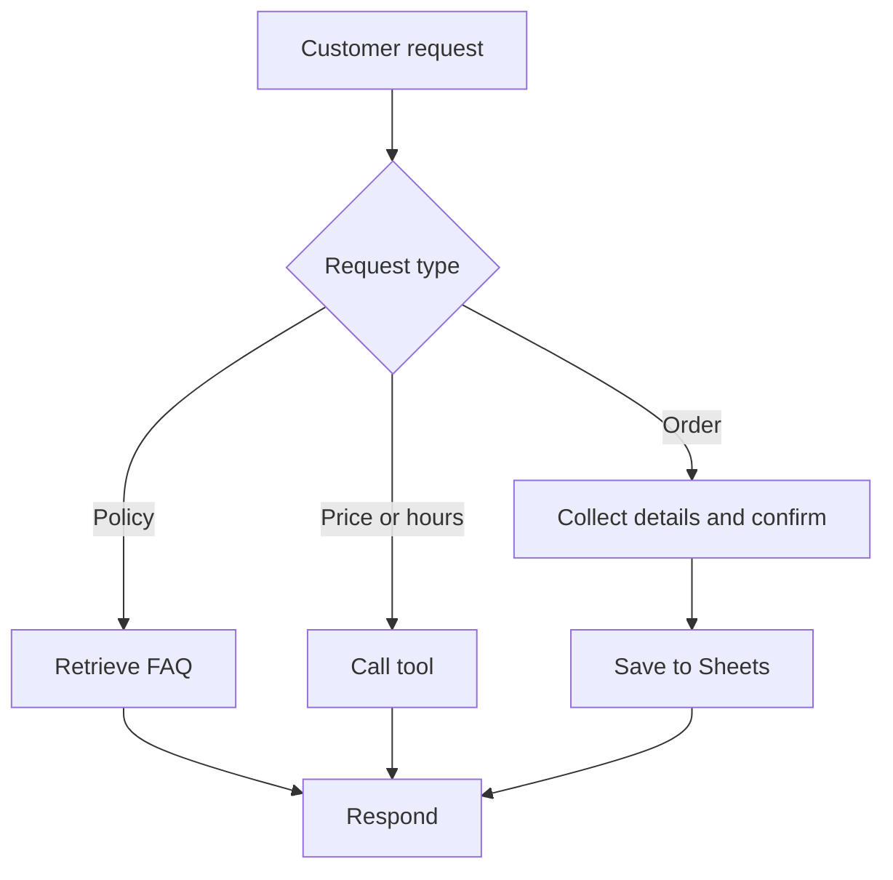

# Day 5 — Memory and RAG

Sweet Crumbs Home Bakery AI agent with semantic policy retrieval and isolated customer conversation threads.

## Features
- 19 policy chunks derived from the workshop FAQ
- ChromaDB and local embeddings
- LangChain tools and LangGraph InMemorySaver
- Groq GPT-OSS 120B
- Optional Google Sheets order logging
- 15 regression questions (10 previous + 5 new)
- Separate PDF RAG exercise using MiniLM and FAISS

## Run in Colab
1. Upload Day_5_Solutions.ipynb, faq.json and tests.csv. Put data files in /content.
2. Add GROQ_API_KEY in Colab Secrets and enable notebook access.
3. Execute cells in order. Enable Sheets only if you want to authenticate and save test orders.
4. Run sign-off once; resume after quota reset if interrupted. Upload generated test_results.csv after reviewing it.
5. For PDF RAG, upload PDF_RAG.ipynb and The_Little_Lantern.pdf and run separately.

## Evaluation
Target: at least 80% (12/15). Actual results pending Colab execution. Substring checks are a basic metric; inspect answers for factual accuracy and thread isolation. The prior Kakinada test retains its original expected fallback; a valid clarification about distance may require manual review.

## Workflow for Day 6

## Limitations
Memory is lost on runtime restart. Embedding model download requires internet. Groq quotas and model availability apply. Retrieval is not a guarantee of accuracy. Live API and Sheets execution have not been verified. Never commit API keys or real customer data. Only publish the supplied PDF if permitted.
